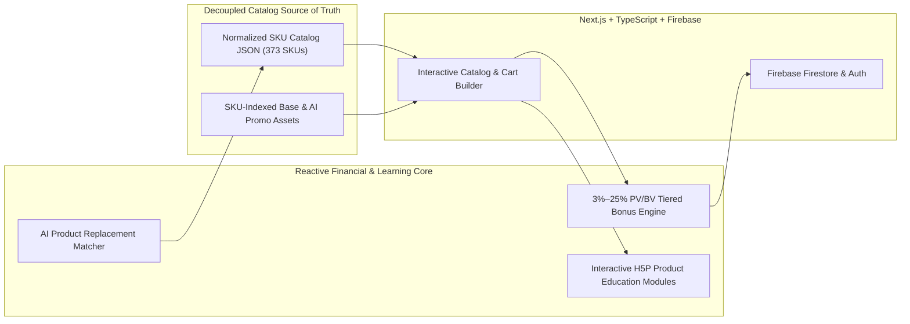

# Customatter — Dynamic Digital Catalog & Multi-Tier PV/BV Financial Simulation Engine

> **Architecture:** Next.js App Router + TypeScript + Static JSON Catalog Source of Truth + Firebase Persistence + Reactive 3%–25% Tiered Compensation Engine  

## 1. Executive Summary & Problem Statement
Independent social-commerce distributors and wellness educators struggle with static PDF price lists, fragmented SKU metadata, and opaque multi-tier bonus calculations across Personal Volume (PV) and Business Volume (BV).

**Customatter** unifies a **373-SKU interactive digital catalog**, **AI-assisted product replacement scanning**, **interactive H5P learning modules**, and a **deterministic 3%–25% PV/BV compensation simulator** into a single full-stack Next.js platform.

---

## 2. System Architecture & Infrastructure Topology



---

## 3. Key Engineering Decisions & Production Highlights

### Decoupled Catalog Pricing & SKU Asset Integrity
* Decoupled hardcoded pricing logic into a validated static JSON source of truth paired with automated SKU image verification (`scripts/normalize-product-images.js`), guaranteeing 1:1 parity between catalog records, `/assets/bases/{SKU}.png`, and `/assets/ai-promos/{SKU}.png`.

### Reactive 3%–25% PV/BV Financial Simulation Engine
* Engineered a deterministic client-side calculation engine modeling multi-tier performance brackets (3% to 25%), differential pass-up volume, and retail margin projections in real time as users adjust cart or team configurations.

### Interactive H5P & AI Replacement Workflows
* Embedded interactive educational modules alongside camera-based OCR/Vision product scanning (`/scan`) so customers can compare everyday household items directly against catalog equivalents.

---

## 4. Repository Structure

```text
customatter/
├── src/
│   ├── app/
│   │   ├── products/           # Searchable 373-SKU catalog & AI promo toggle
│   │   ├── scan/               # Camera OCR + Gemini/Vertex replacement builder
│   │   └── calculator/         # 3%–25% tiered PV/BV financial simulator
│   ├── data/                   # Decoupled static JSON catalog & pricing schemas
│   └── lib/                    # Compensation math, Firebase adapters & validators
├── public/assets/              # SKU-indexed base & AI-generated promotional images
├── scripts/                    # Catalog normalization & asset integrity checks
└── package.json                # Next.js, TypeScript, Firebase & testing scripts
```

---

## 5. Local Development & Verification

```bash
# 1. Install dependencies
npm ci

# 2. Verify SKU asset integrity across all 373 catalog items
npm run catalog:check-images

# 3. Start local development server
npm run dev

# 4. Run typecheck, unit tests, and production build
npm run typecheck && npm run test && npm run build
```
